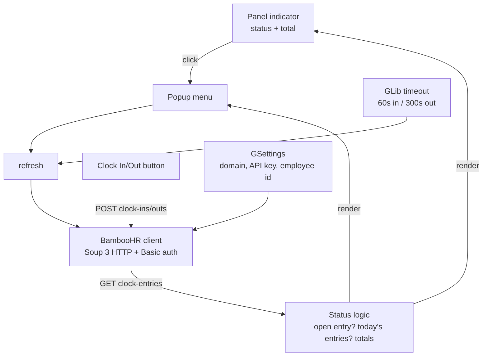

# Plan: BambooHR Clock-In GNOME Extension

> **Targets:** GNOME Shell 51 · GJS ESM · **TypeScript** · **API key auth**
>
> A GNOME Shell extension with a panel indicator showing your BambooHR clock-in
> status and today's total logged time. Clicking it opens a popup with today's
> time entries, the day's total, and a **Clock In / Clock Out** button.

## 1. Overview

```
┌─────────────────────────────────────┐
│  Panel indicator (always visible)   │
│  "● Clocked in · 4h 12m"  or  "○    │
│  Not clocked in"                    │
└─────────────────────────────────────┘
            │ click
            ▼
┌─────────────────────────────────────┐
│  Popup menu                         │
│  ──────────────────────             │
│  Status: Clocked in since 09:02     │
│  ──────────────────────             │
│  09:02 – 11:30         2h 28m       │
│  11:45 – 13:00         1h 15m       │
│  13:10 – (live)        0h 42m       │
│  ──────────────────────             │
│  Total today            4h 25m      │
│  ──────────────────────             │
│  [  Clock Out  ]   [ Refresh ]      │
└─────────────────────────────────────┘
```

## 2. BambooHR API usage (verified against docs)

Base URL: `https://{companyDomain}.bamboohr.com/api/v1`

| Purpose                  | Endpoint                                                                                                                                                 | Notes                                                                                                                                                                                 |
| ------------------------ | -------------------------------------------------------------------------------------------------------------------------------------------------------- | ------------------------------------------------------------------------------------------------------------------------------------------------------------------------------------- |
| Auth                     | Basic auth                                                                                                                                               | Username = API key, password = `x` (docs' convention).                                                                                                                                |
| Identify self            | `GET /employees/0`                                                                                                                                       | Employee ID `0` resolves to the authenticated caller's own record → gives `id`.                                                                                                       |
| Status + today's entries | `GET /time-tracking/clock-entries?filter=employeeId eq {id} and start ge {yesterday 00:00Z} and start le {tomorrow 23:59Z}&sort=start desc&pageSize=200` | OData filter on `employeeId`/`start`/`end`; paginated `{meta, data}`. Fetch a 48h window so an open entry from yesterday isn't missed; filter to "today" locally.                     |
| Clock in                 | `POST /time-tracking/clock-ins` `{"employeeId": 384, "timezone": "America/Denver"}`                                                                      | `timezone` (IANA) is **required** → use the local timezone ID (`Intl.DateTimeFormat().resolvedOptions().timeZone` in GJS). Returns entry with `end: null`. 409 if already clocked in. |
| Clock out                | `POST /time-tracking/clock-outs` `{"employeeId": 384}`                                                                                                   | Returns closed entry. 404/409 if not clocked in.                                                                                                                                      |

**Status derivation:** an open clock entry (`end` is `null`) = clocked in; `start`
gives "since" time. **Today's total:** sum of `hours` over entries whose `date`
== today (in the entry's timezone), plus `now − start` for the live open entry.

**Runtime prerequisites:** company has Time Tracking with clock in/out enabled
(timesheet type `CLOCK`); the API user has permission to view/edit timesheets.
Errors to handle: 401/403 (bad key / disabled key / permissions), 404, 409, 422.

## 3. Architecture



- **`src/extension.ts`** — GNOME 45+ ESM `Extension` class; owns the panel
  indicator, popup menu, and refresh timers.
- **`src/lib/bamboohr.ts`** — typed API client (Soup 3 `Session`, manual
  `Authorization: Basic` header).
- **`src/lib/status.ts`** — pure logic: classify entries, compute totals.
- **`src/prefs.ts`** — settings dialog (company domain, API key, employee ID,
  refresh interval).
- **`schemas/*.gschema.xml`** — GSettings schema backing the settings.

## 4. File structure

```
bamboo_gnome_extension/
├── metadata.json                 # uuid, name, shell-version: ["51"]
├── src/
│   ├── extension.ts              # indicator + popup + lifecycle
│   ├── prefs.ts                  # settings dialog
│   └── lib/
│       ├── bamboohr.ts           # API client
│       ├── status.ts             # status/total computation + formatting
│       └── settings.ts           # GSettings schema wrapper (typed)
├── schemas/
│   └── org.gnome.shell.extensions.bamboo-timesheet.gschema.xml
├── stylesheet.css
├── package.json                  # dev-only: typescript + @girs type packages
├── tsconfig.json
├── build.mjs                     # ESBuild bundle + build/ copy step
├── install.sh                    # dev install → ~/.local/share/gnome-shell/extensions/
├── README.md
└── PLAN.md
```

## 5. Implementation phases

**Phase 1 — Scaffold & settings ✅**

- Toolchain: `package.json` + `tsconfig.json` + `build.mjs` (ESBuild bundles
  `src/extension.ts`, `src/prefs.ts`, and a standalone `status-test.js` test
  bundle to single ESM files for GJS 1.72+).
- `metadata.json` with `uuid: bamboo-timesheet@user`, `shell-version: ["51"]`,
  `"type": "extension"` (resource-based extension: gnome-shell 51 loads compiled
  schemas from the extension dir automatically; ESBuild bundles the GSettings
  schema into `compiled/gsettings-schemas/` and sets `GSETTINGS_SCHEMA_DIR`).
- GSettings schema `org.gnome.shell.extensions.bamboo-timesheet`:
  - `company-domain` (string)
  - `api-key` (string; optionally the keyring in Phase 6)
  - `employee-id` (int, 0 = auto-detect via `GET /employees/0`)
  - `refresh-interval-in` (int seconds, default 60)
  - `refresh-interval-out` (int seconds, default 300)
- `src/lib/settings.ts` — typed wrapper around GSettings.
- `src/prefs.ts` — Adw/GTK4 preferences dialog bound to the schema.
- `install.sh` — build + stage into `~/.local/share/gnome-shell/extensions/`.

**Phase 2 — API client ✅** (`src/lib/bamboohr.ts`)

- Soup 3 session with 10s timeout (via `Gio.Cancellable`), JSON encode/decode,
  `Basic base64(key + ":x")`.
- `getSelf()`, `listClockEntries(employeeId, from, to)`, `clockIn()`, `clockOut()`;
  HTTP statuses → `BambooApiError` with friendly messages.
- `src/lib/types.ts` — typed response/request shapes.

**Phase 3 — Status logic ✅** (`src/lib/status.ts`)

- `summarizeToday(entries, now)`: open entry → `clockedIn`, `clockedInSince`;
  entries with `date === today(entry.timezone)` → today's list; `totalMs =
Σ hours + live duration`; `formatDuration`/`formatTime` helpers.
- Unit-tested under GJS (`gjs test-status.js`, 20 assertions incl. timezone
  midnight boundary + overnight-open-entry cases).

**Phase 4 — Panel indicator & popup ✅** (`src/extension.ts`)

- `PanelMenu.Button` indicator added via `Main.panel.addToStatusArea()`; label
  `● Clocked in · 4h 12m` / `○ Not clocked in` (green when clocked in, gray
  otherwise, red on error with no data), re-rendered every 60s — a GLib timer
  that re-renders live durations locally and refreshes from the API (Phase 5
  switches this to the settings-driven 60s-in / 300s-out intervals).
- `PopupMenu`: status header (`Clocked in since HH:MM` / not clocked in /
  `Refreshing…` / error), today's entries (non-reactive rows `start–end` |
  duration, the open entry rendered as a green `HH:MM – (live)` row),
  "No entries today" empty row, `Total today` row, Clock In/Out item (POSTs
  `/time-tracking/clock-ins` / `/time-tracking/clock-outs` with the local IANA
  timezone), Refresh, and "Open BambooHR" (default browser via `Gio.AppInfo`).
- Fetch uses the 48h window + per-entry-timezone summarization from
  `status.ts`; employee id auto-resolves via `GET /employees/0` and is cached.
- Cleanup in `disable()`: timer removed, indicator destroyed (panel entry +
  menu + item signals), Soup session aborted via the new `BambooClient.abort()`
  (cancelled requests surface as "Request cancelled", distinct from timeouts).
- GObject/GJS classes here use the `_init()` + `declare`-only fields pattern:
  GJS dispatches `_init` before subclass field initializers run, so fields with
  initializers would clobber values assigned in `_init`.

**Phase 5 — Refresh & lifecycle ✅**

- `GLib.timeout_add_seconds`: 60s while clocked in (keeps total ticking),
  300s otherwise; refresh on popup open and after actions; guard against
  overlapping requests with `Gio.Cancellable`; clean up all sources + disconnect
  signals in `disable()`.

  Implemented as a one-shot timer re-armed after every refresh attempt
  (success or failure) with the interval for the current clock state, so
  interval/clock-state changes take effect on the next cycle. Refreshes are
  superseded via a `Gio.Cancellable` chained into the client's per-request
  tokens; clock in/out POSTs are guarded by a separate action-busy flag and
  notify only while the extension is still enabled.

**Phase 6 — Error/empty states & polish**

- Not configured ("Click to configure"), network error, 401/403 (bad
  key/permissions), 409 conflict, "No entries today" empty state; stylesheet;
  README with setup steps (get API key from BambooHR user menu → API Keys).

## 6. Validation plan

1. **API sanity via curl** first: `curl -u "{API_KEY}:x" "https://{domain}.bamboohr.com/api/v1/employees/0"` and the clock-entries query — confirms permissions, employee ID, and response shape before wiring UI.
2. **Build**: `npm install && npm run build` → `dist/extension.js`, `dist/prefs.js`.
3. **Install & enable**: `./install.sh` → `gnome-extensions enable bamboo-timesheet@user`; reload shell (`Alt+F2 r` on X11, or restart session on Wayland).
4. **Debug**: `journalctl -f /usr/bin/gnome-shell`, `GJS_DEBUG_OUTPUT=all`, Looking Glass (`lg`).
5. Test clock in → indicator goes live + total ticks; clock out → entry closes and total freezes; restart shell while clocked in → status persists (fetched from API, not local state).

## 7. Open decisions (resolved)

1. **Auth:** API key via Basic auth (no OAuth app registration needed). ✅
2. **Language:** TypeScript compiled to ESM bundles for GJS. ✅
3. **GNOME target:** Shell 51 (GNOME 51). ✅

## 8. Risks / gotchas

- **Company config**: clock in/out only works if Time Tracking is enabled and the timesheet type is `CLOCK`; otherwise 409/422 errors.
- **API key lockout**: BambooHR temporarily disables API access after repeated bad keys — treat 403 as "stop retrying, surface a message."
- **Timezone/midnight edge**: entries carry their own IANA timezone and `date`; compute "today" from the entry's timezone, not the system's, to avoid off-by-one at midnight.
- **Open entries across days**: an open entry started yesterday is still "clocked in" — the 48h fetch window handles this.
- **GJS ESM + TypeScript**: no Node-style module resolution at runtime; bundles must be single-file ESM with `import` of GObject/Gtk etc. only from GJS-provided modules (handled by ESBuild with `external`).
